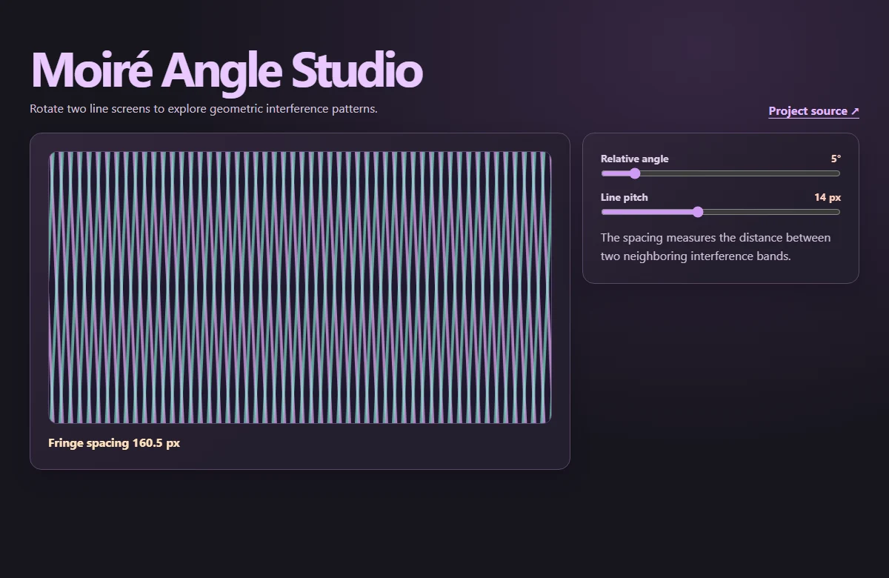

# Moiré Angle Studio

Rotate two line screens to explore geometric interference patterns.

[Open the browser app](https://surfingcoder.com/apps/moire-angle-studio/)

## Run locally

Run the following command in this repository and open [localhost:8000](http://localhost:8000).

    python -m http.server 8000

Two line screens have equal pitch and rotate in opposite directions relative to the center. Fringe spacing is pitch divided by twice the sine of half the relative angle. Parallel screens have no finite fringe spacing.

## Verify

Run the following command with Node.js 22 or newer.

    node --test
